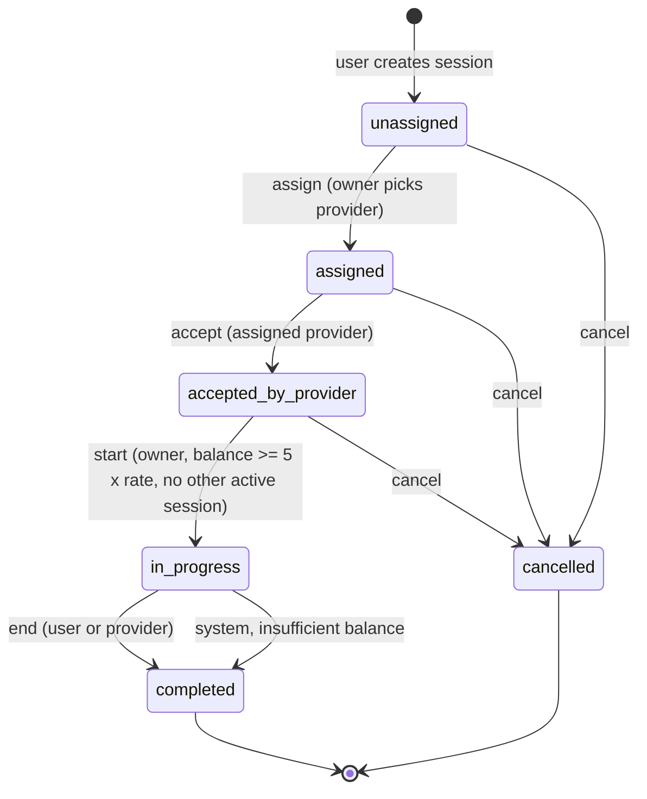
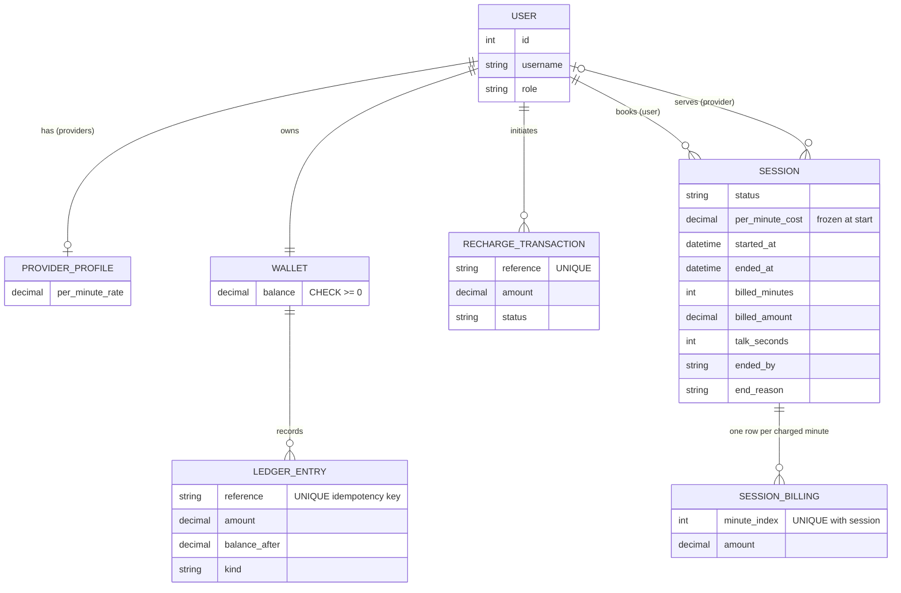
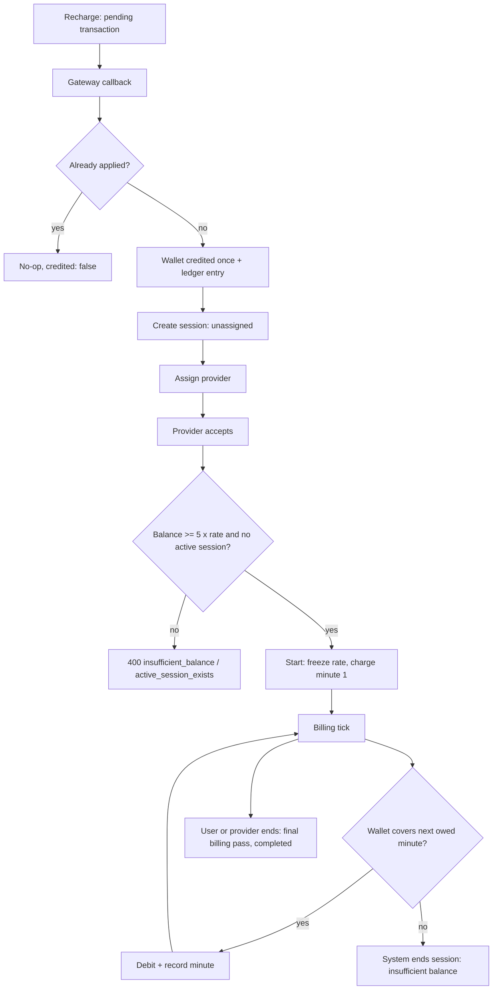

# Wallet-Based Per-Minute Session Billing

Django + Django REST Framework backend for paid 1:1 consultation sessions: a prepaid wallet,
a session state machine, per-minute billing, automatic end on insufficient balance, and
idempotent money handling. PostgreSQL is supported and recommended; SQLite works for local dev.

> Design rationale and trade-offs: **[DECISIONS.md](DECISIONS.md)**

## Setup

```bash
python -m venv .venv && source .venv/bin/activate
pip install -r requirements.txt
python manage.py migrate
python manage.py runserver
```

Tested on Python 3.12, Django 6.1, DRF 3.18. No other services required.

### PostgreSQL (optional)

```bash
pip install -r requirements-postgres.txt
export POSTGRES_DB=astro POSTGRES_USER=postgres POSTGRES_PASSWORD=... POSTGRES_HOST=localhost
python manage.py migrate
```

If `POSTGRES_DB` is not set, SQLite is used.

## Run the tests

```bash
python manage.py test              # whole suite
python manage.py test tests.test_required_scenarios -v 2   # the six scenarios from the brief
```

55 tests. On SQLite, 3 concurrency tests are **skipped** (SQLite has no `SELECT ... FOR UPDATE`).
Run the suite with `POSTGRES_DB` set to execute them: those tests fire 8 parallel threads at
billing, duplicate callbacks and simultaneous session starts. All 55 pass on PostgreSQL 16.

| Brief scenario | Test |
|---|---|
| 1. Insufficient balance | `test_required_scenarios.test_1_insufficient_balance_cannot_start` |
| 2. Happy path | `test_required_scenarios.test_2_happy_path` |
| 3. Balance runs out | `test_required_scenarios.test_3_balance_runs_out_mid_session` |
| 4. Invalid state transition | `test_required_scenarios.test_4_invalid_transition_returns_400` (+ full matrix in `test_state_machine`) |
| 5. Duplicate recharge callback | `test_required_scenarios.test_5_duplicate_recharge_callback_credits_once` |
| 6. Duplicate billing | `test_required_scenarios.test_6_duplicate_billing_does_not_double_charge` |

Tests never sleep: `timezone.now` is replaced by a controllable clock.

## Periodic billing

Billing is lazy and idempotent: it bills whatever is owed *at the moment it is called*. Trigger it with
either the endpoint (`POST /api/sessions/{id}/bill/`) or, for all active sessions at once:

```bash
python manage.py bill_active_sessions          # run every ~10s from cron / systemd timer / `watch -n 10`
```

## API

All endpoints are under `/api`. Auth: `Authorization: Token <key>`.

| Method & path | Who | Purpose |
|---|---|---|
| `POST /auth/register/` | anyone | `{username, password, role: USER\|PROVIDER, per_minute_rate (providers only)}` -> token |
| `POST /auth/token/` | anyone | `{username, password}` -> token |
| `GET  /auth/providers/` | any | list providers and their rates |
| `GET  /wallet/` | any | current balance |
| `POST /wallet/recharge/` | any | `{amount}` -> pending transaction with a `reference` |
| `POST /wallet/recharge/callback/` | gateway | `{reference, status: success\|failed}`; header `X-Webhook-Secret` |
| `POST /sessions/` | USER | create session (`unassigned`) |
| `POST /sessions/{id}/assign/` | owner | `{provider_id}` |
| `POST /sessions/{id}/accept/` | assigned provider | |
| `POST /sessions/{id}/start/` | owner | needs balance >= 5 x rate; charges minute 1 |
| `POST /sessions/{id}/end/` | owner or provider | final billing pass, then completes |
| `POST /sessions/{id}/cancel/` | owner or provider | only before `in_progress` |
| `POST /sessions/{id}/bill/` | owner or provider | bill up to now; returns `minutes_billed_now` |
| `GET  /sessions/`, `/sessions/{id}/` | participants | list / detail |

Errors: `400` invalid transition / insufficient balance / second active session, `403` wrong role or
not your session, `404` unknown, `409` conflicting recharge callback. Business errors look like:

```json
{"error": "Cannot end a session that is 'assigned'. 'end' is only allowed from: in_progress.",
 "code": "invalid_transition", "action": "end", "current_status": "assigned"}
```

### Quick walkthrough

```bash
B=http://127.0.0.1:8000/api
curl -sX POST $B/auth/register/ -H 'Content-Type: application/json' \
  -d '{"username":"asha","password":"pw-12345678","role":"USER"}'                       # -> token (user)
curl -sX POST $B/auth/register/ -H 'Content-Type: application/json' \
  -d '{"username":"guruji","password":"pw-12345678","role":"PROVIDER","per_minute_rate":"50"}'
# recharge, then simulate the gateway callback (send it twice - credited once)
curl -sX POST $B/wallet/recharge/ -H "Authorization: Token $USER_TOKEN" -H 'Content-Type: application/json' -d '{"amount":"300"}'
curl -sX POST $B/wallet/recharge/callback/ -H 'X-Webhook-Secret: dev-webhook-secret' \
  -H 'Content-Type: application/json' -d '{"reference":"rch_...","status":"success"}'
```

## State diagram



Any action not drawn above returns `400 invalid_transition`. The table lives in
`consultations/services.py::TRANSITIONS`.

## ER diagram



Database-level guarantees: `wallet.balance >= 0`; one `in_progress` session per user (partial unique
index); `(session, minute_index)` unique; ledger `reference` unique; recharge `reference` unique.

## How it works



A billing tick computes `minutes_due = max(1, ceil(elapsed / 60))`, then debits each unbilled minute
in turn. The debit is one conditional `UPDATE ... WHERE balance >= amount`, so the wallet cannot go
negative. The first unpayable minute ends the session at the paid boundary. Ticking twice, late, or
in parallel never charges a minute twice.

## Functionality

| Area | What it does | Rule enforced |
|---|---|---|
| Accounts | Register as `USER` or `PROVIDER`, token login, list providers | Providers must have a rate |
| Wallet | View balance | Never negative (code guard + DB `CHECK`) |
| Recharge | Initiate, then complete via mock gateway callback | Same callback twice credits once; conflicting callback is 409 |
| Sessions | Create, assign, accept, start, end, cancel | Invalid transition is 400; wrong person is 403 |
| Start | Begin the paid session | Balance >= 5 x rate; one `in_progress` session per user; rate frozen; minute 1 charged |
| Billing | `bill` endpoint or `bill_active_sessions` command | Each started minute charged once; late ticks catch up |
| Auto-end | Part of every tick | `system: Insufficient Balance`, wallet untouched, talk time saved |
| Audit | Ledger entry per money movement, row per billed minute | Unique keys make a duplicate movement impossible |

## Testing guide

Automated: see "Run the tests" above (55 tests; run once on PostgreSQL to include the concurrency tests).

Manual checks (with the playground below, or `curl`):

| Do this | Expect |
|---|---|
| Fund 200, try to start at 50/min | 400 `insufficient_balance` (needs 250) |
| Fund 290 and start | `in_progress`, balance 240, 1 minute billed |
| Jump 3 minutes, bill three times in a row | Only the first bill charges |
| Jump 60 minutes, run a tick | `completed`, ended by `system`, 5 minutes billed, wallet 40 |
| Send the same success callback twice | Credited once (`credited: false` the second time) |
| Wrong secret / `failed` after `success` | 403 / 409 |
| End a session that never started | 400 `invalid_transition` |
| Act as another user on someone's session | 403 |
| Start a second session while one is running | 400 `active_session_exists` |

After any experiment, the sum of ledger entries per wallet must equal that wallet's balance.

## Local playground (optional, dev only)

`playground.html`, `chat.html` and `playground.py` sit next to `manage.py` and are served at
`/play/` when `DEBUG` is on. `config/urls.py` loads `playground.py` if it exists. They give you
account switching, a mock gateway, a time machine, database tables, a request log, and a pop-up
test chat (`/play/chat/`, opened by the "Open chat" button). Chat messages live in the browser's
`localStorage` only; billing calls are real. **Delete these three files and revert the hook in
`config/urls.py` before submitting.** They include endpoints that wipe data and rewrite session
start times.

## Layout

```
accounts/        custom User (role), ProviderProfile (rate), register/token endpoints
wallet/          Wallet, RechargeTransaction, LedgerEntry; services.py is the only place balances change
consultations/   Session, SessionBilling; services.py = state machine + billing; management command
common/          domain exceptions + DRF error handler
tests/           required scenarios, wallet, state machine, billing, accounts, concurrency
playground.*, chat.html   optional dev-only UI (see above)
```